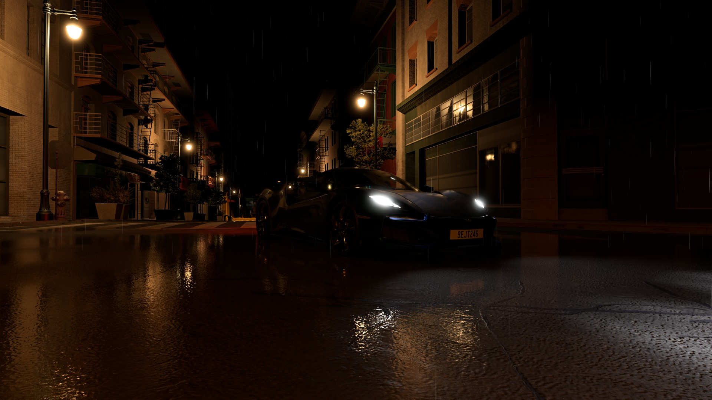
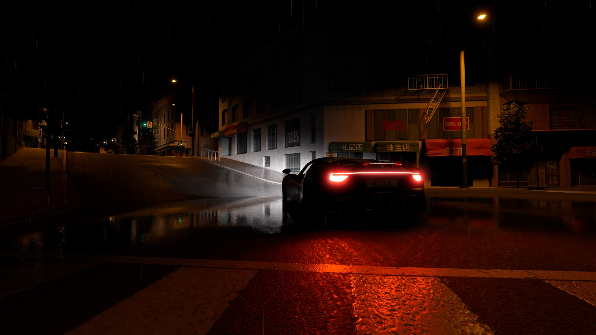
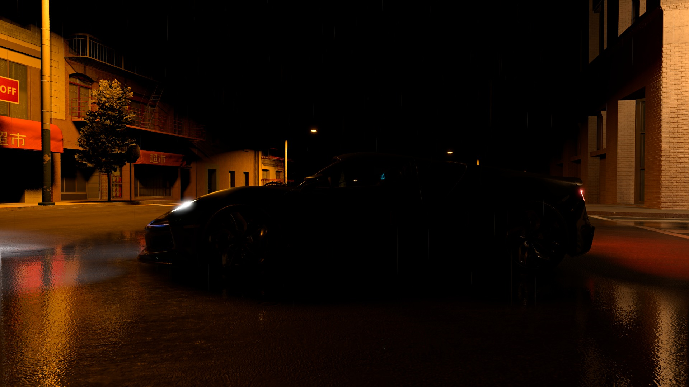
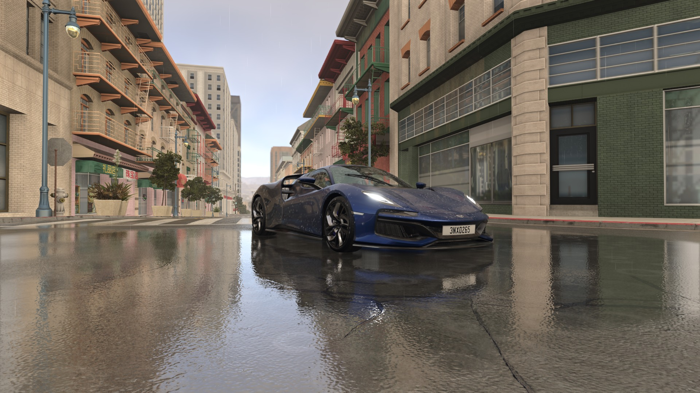
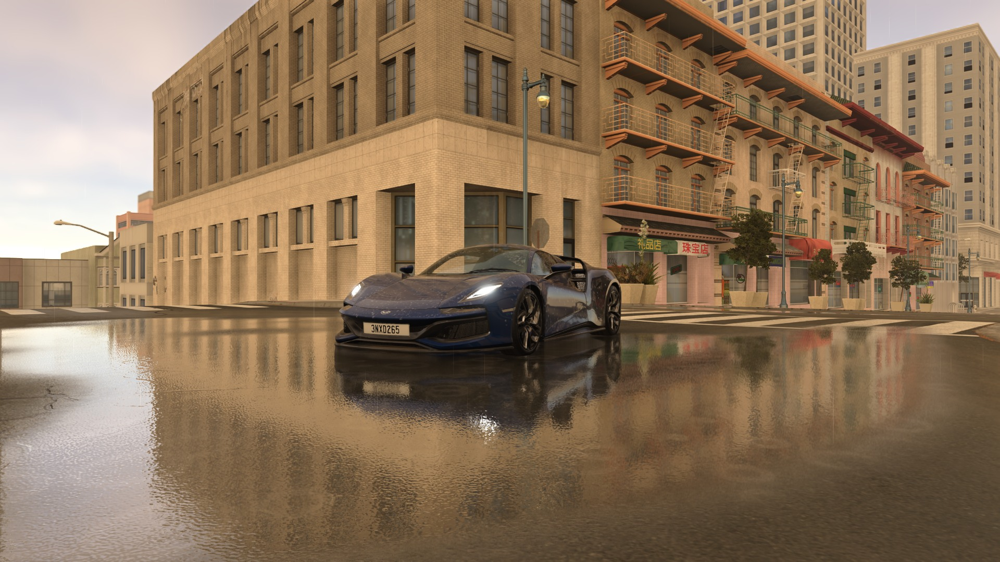
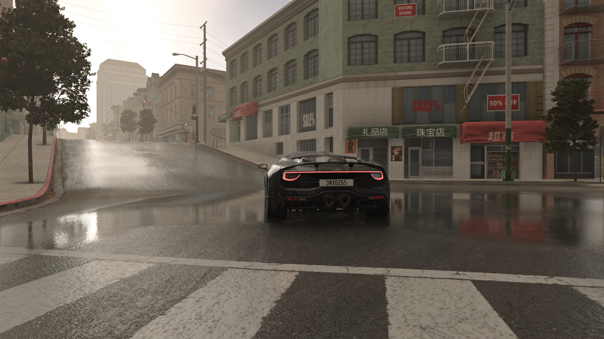
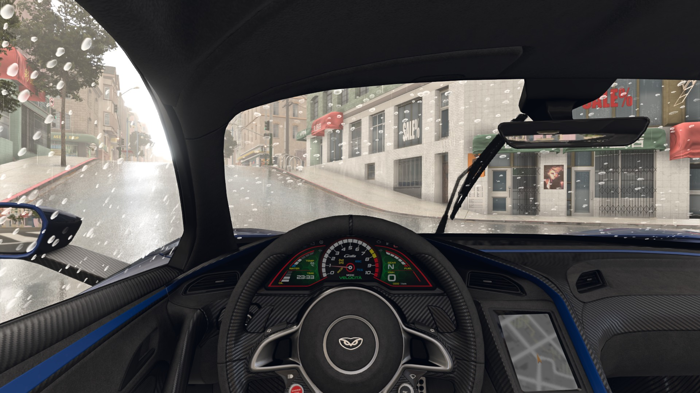
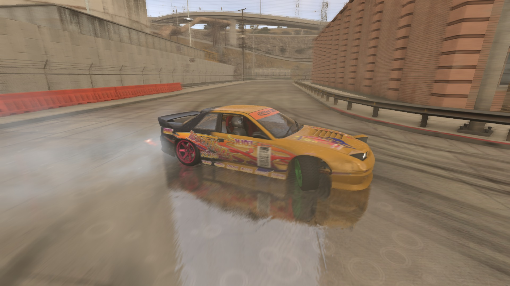
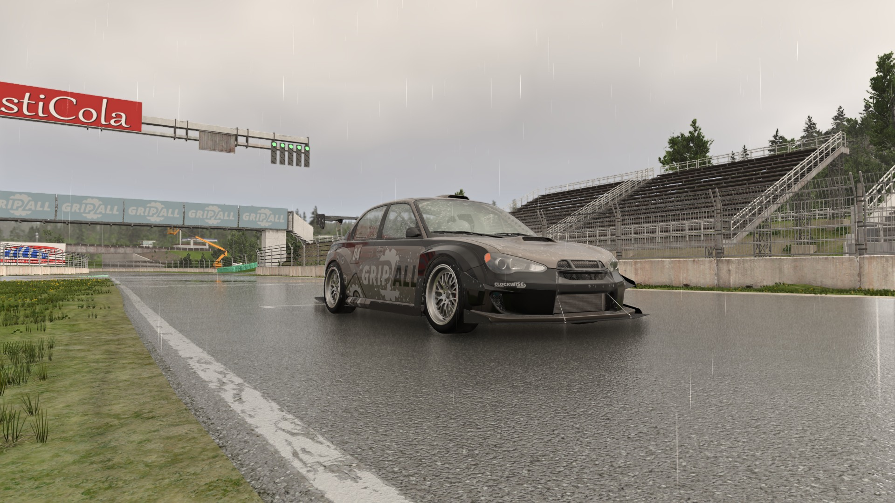
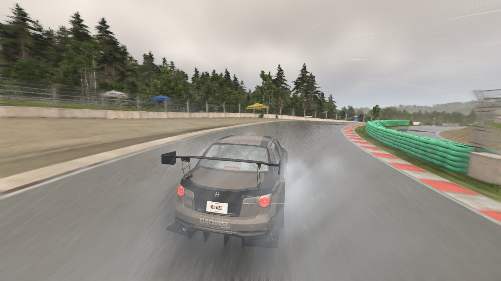

# ForeverWEATHER: Rain Puddles & Droplets

Falling rain, wet roads, puddles with reflections, node-based hydroplaning, body droplets, rain on the windshield, rear and side windows with real wipers, fogged glass, rain you can hear, lens drops, dry tunnels and tyre spray.

A graphics and physics mod for **BeamNG.drive 0.40.x** (version 1.6.0, **pre-release**). Everything is drawn by the mod's
own compute shaders and Lua; it needs no other mod.

> **DX12 and Vulkan only.** DX11 doesn't support SSR on BeamNG.drive currently, and the mod utilizes SSR for the puddles.
> 
> **Pre-release: untested.** New builds are published as GitHub pre-releases, and 1.6.0 has not been tested in game
> yet. Expect bugs, and please report them in the [Issues tab](https://github.com/Blaze-Archi/ForeverWEATHER/issues)
> (there is a *Bug report* form).
>
> **Made with AI.** This mod was written by an AI assistant, Claude (by Anthropic) working in Claude Code: all of its
> code, shaders, settings panel and texts, including this page. Blaze-Archi directed the work, tested it in game and
> chose what stays. See [About the AI](#about-the-ai) below.

## What it does

- Wet asphalt that darkens and turns glossy with the rain, plus puddles on roads with screen-space reflections, simulated ripples (every raindrop and tyre makes rings that spread, cross and fade) and tyre wakes. Water only stands on level ground: no puddles on hills.
- Droplets on every nearby car: round beads, teardrops and elongated running drops that bead, run off with gravity and stream backward with the airflow. Each one is a small lens: clear water that shows an upside-down view of what is around it, and its rim catches bright light (the sky over a dark car, lit streets and lamps at night), so the drops show in the dark too.
- Rain on your car's windshield, rear / hatch glass and side windows, from the driver's seat and from outside, cleared by automatic rain-sensing wipers. The drops on the glass are lenses like the ones on the paint. On the windshield and the rear glass the water is simulated: the wipers push it into lines at the ends of their sweep, whose big drops then run off with gravity and the airflow, and leave a hazy smear; the wiped glass fills up again with the rain while the water runs with speed and gravity.
- Fogged glass: in damp air (drizzle, fog, the wet world after the rain) a fine mist settles on the outside of the windshield, rear and side windows. It blurs the view (lights get halos) and turns the windows milky from outside. The wipers wipe it off along their sweep and it comes back, faster when you drive; drops stay clear in it and running drops cut channels through it.
- A hint of mist on the cars: a faint satin bloom of condensation on cars that stand in damp air, on the roof, the hood and the boot lid, not on a hood the engine has just warmed.
- Rain you can hear: a patter or a downpour's roar through the game's sound engine. It turns muffled under a bridge or a roof, almost goes in a tunnel, and from the driver's seat the rain drums on the roof.
- Drops on the camera lens all over the screen: round drops that land at random, spread out from the point ahead as you drive (the faster, the quicker) and slide down the lens when you slow down or stop.
- Node-based hydroplaning (Arcade / Simcade / Sim): the water under each tyre's contact-patch nodes (the road film and exactly the puddles you see) lifts them off the road against the tyre's own pressure and drags them back, so grip fades in deep water at speed and one wheel in a puddle pulls the car.
- Tunnels, bridges and roofs: the ground under them stays dry and does not reflect, no rain lands on the glass there, the wipers finish a couple of sweeps and stop, and the drops on the cars slowly go (faster the faster you drive).
- Works together with the "Animated Wipers" mod if you have it (optional; nothing of it is included or changed): the rain sensor uses that mod's own wiper switch, and the glass clears exactly as its blades move.
- Its own falling rain, drawn on the graphics card instead of BeamNG's particle rain (which costs about 4 ms of CPU time per frame in heavy rain). Each drop refracts the scene behind it like a tiny lens.
- Tyre spray and wakes in puddles, and a simulated mist (Navier-Stokes): the spray the air carries off hangs behind the cars, swirls in their wake and fades. At night the spray takes the colour of the lights around it: red behind a car from its tail lights, orange under sodium street lamps.
- The ground gets wet and dries over time. It can follow the game's own weather, and on the BeamNG.Earth map that map's real weather (the bridge is built in).

**Pause menu > Mods > ForeverWEATHER.** Not sure what to tune? Use the Quick look buttons (Damp / Wet / Storm / Flooded) at the top. Console: `extensions.rainPuddles.openUI()`

## Hydroplaning

Node-based, in each car's own physics at the physics rate (2000 Hz):

1. **Contact patch.** Every tyre's tread nodes are put in ring order around the axle; the ones touching the road are
   followed as the wheel turns.
2. **Water under each node.** The road's water film plus the puddles, from exactly the puddle field the shader draws
   (the same masks, tiling, coverage and depth ramp), inside the road lanes, never under a roof, only on level ground
   (the same slope limit as the puddles you see) and only on hard ground (asphalt, concrete, cobbles). Dirt, grass and
   sand soak the water up.
3. **Drainage.** The tread drains what it can: tread depth by tyre type (slicks, semi-slicks, race, off-road tyres are
   recognised by part name) or the *Tread depth* setting, less at speed.
4. **Lift.** The water pressure in front of the patch, ½ ρ v² C_L, against the tyre's real inflation pressure, carries
   part of each node's load: the node is pushed up off the road and BeamNG's own tyre model loses the grip there. No
   friction value is faked. A 2.2 bar road tyre floats completely at about 95 km/h in a deep puddle (*Sim*), close to
   Horne's classic V ≈ 6.36 √p (kPa) km/h.
5. **Drag.** The water the tyre has to push aside drags its leading nodes back: the wheel slows (spin-down) and one
   wheel in a puddle pulls the car.

| Mode | Lift coefficient | Most of the load the water can carry | Water needed above what the tread drains |
|---|---|---|---|
| Arcade | 0.30 | 45 % | 6 mm |
| Simcade | 0.45 | 65 % | 4 mm |
| Sim | 0.70 | 95 % | 2.5 mm |

Settings: *Water strength*, *Tread depth*, traffic too (within 400 m), and a debug view that colours every contact-patch
node (blue = water under it, red = load the water carries). Cost: about 0.05 ms per frame for the player's car.

## Screenshots

In game, at the author's own graphics settings, not edited. Taken with 1.3.x: the night shots still show Midnight's grade
and the street-lamp highlights that 1.4.0 removed.

**Night**

<table>
<tr><td></td><td></td></tr>
<tr><td></td><td></td></tr>
<tr><td></td><td></td></tr>
</table>

**Day**

<table>
<tr><td></td><td></td></tr>
<tr><td></td><td></td></tr>
<tr><td></td><td></td></tr>
<tr><td></td><td></td></tr>
</table>

## Install

1. Close the game.
2. Download `ForeverWEATHER.zip` from the newest build on the [Releases page](https://github.com/Blaze-Archi/ForeverWEATHER/releases)
   (or [`release/ForeverWEATHER.zip`](release/ForeverWEATHER.zip)) and put it, still zipped, into
   `<BeamNG user folder>/current/mods/`. Remove older `rainPuddles.zip` / `rain_puddles` zips and the old
   `rainPuddles_earth.zip` companion first: since 1.2.0 the zip is called ForeverWEATHER, and the BeamNG.Earth bridge has
   been inside it since 1.0.2. Your settings stay. (New builds are pre-releases, which GitHub's "latest release" link
   skips: take the newest one on the Releases page.)
3. Start the game, load a map, press Esc and open **Mods > ForeverWEATHER**.

Add or remove the zip only while the game is closed: the game's mod manager drops a zip that appears or disappears
while it runs.

The repository root has the same layout as the zip (`art/`, `lua/`, `mod_info/`, `scripts/`, `shaders/`, `ui/`), so a
copy of it in `mods/unpacked/foreverweather/` also works for development. After editing a shader, rename its folder
(`shaders/common/postFx/rainPuddlesNN`) and `shaderDir` in `lua/ge/extensions/rainPuddles.lua`, or the game keeps the
compiled old one.

## What's new in 1.6.0

**Pre-release: untested in game.** Please report bugs in the [Issues tab](https://github.com/Blaze-Archi/ForeverWEATHER/issues).

- **Glass fog.** A fine mist on the outside of the glass in damp air, drawn over a Dual Kawase blur of the view (five
  small passes that only run while some glass near you is fogged). The wipers wipe it off along their real sweep, it
  comes back gradually (faster at speed), the automatic wipers also wipe now and then in fog, drops stay clear in it and
  running drops cut clear channels through it. From the seat the cabin is kept out of the blur, so the dashboard never
  smears into the view. *Glass fog & body mist*.
- **Body mist.** A subtle condensation bloom on cars that stand in damp air: most on the roof, the hood and the boot
  lid, not on a warm hood, kept off by driving. It softens the clear coat's reflection and is easiest to see on dark
  paint.
- **Rain sound.** Synthesised rain loops through the game's FMOD: a patter or a roar with the rain, muffled and fading
  under bridges, roofs and in tunnels (from the shelter grid the mod already keeps, no extra ray casts), the body
  muffling it and the rain drumming on the roof from the driver's seat. *Rain sound*.
- **Calmer puddles.** The rain's rings in the puddles are half as strong; the tyres' wakes keep their full strength.
- **Simulated mist fixed** after vehicle resets and teleports (the tyres are held for a moment and the air restarts
  from calm) and around cars that stand still (a wheelspin no longer piles mist up, a parked car's wake comes to rest,
  no runaway swirls in still air).
- **Pre-release builds** from a GitHub workflow, with an untested notice in the release notes and in the zip.

Full notes: [docs/history/CHANGES_v1.6.0.md](docs/history/CHANGES_v1.6.0.md).

## What's new in 1.5.2

- **Clearer big glass drops.** Big drops on the glass are flat like real ones: clear in the middle with a thin curved
  rim, instead of white blobs that showed a far-off patch of sky.
- **Lens drops that move with the air and gravity.** The round drops on the camera lens land at random. Driving, they
  spread out from the point the camera moves toward, the faster the quicker; slow or parked, they slide down the lens.

Full notes: [docs/history/CHANGES_v1.5.2.md](docs/history/CHANGES_v1.5.2.md).

## What's new in 1.5.1

- **Water lines that run off.** The water the wipers leave at the ends of their sweep no longer sits there as beads
  that only fade: the line drains, and its big drops let go and run off along the path the water on the glass really
  takes, down with gravity when you stand, up and off the glass in the airflow at speed, each leaving a thin wet trail.
  The small drops stay until the next wipe.

Full notes: [docs/history/CHANGES_v1.5.1.md](docs/history/CHANGES_v1.5.1.md).

## What's new in 1.5.0

Simulated water and air.

- **Simulated ripples.** The water in the puddles near you is a simulation: every raindrop makes a ring, a tyre rolling
  through pushes the water aside, the rings spread, cross and fade. *Puddles > Simulated ripples*.
- **Navier-Stokes tyre mist.** The fine spray hangs in the air and goes where the air goes: three air layers above the
  road, simulated as an incompressible fluid every frame. Cars drag the air into a wake with swirls at its sides; a
  passing car leaves a trail of mist over the road that fades within about 1.5 s. *Tyre spray & wakes > Simulated mist*.
- **Glass water.** On the windshield and the rear glass the water is simulated: the wiped glass fills up again with the
  rain while the old water runs off with speed and gravity; the blades push the water into lines of big drops where they
  turn and park, and onto the body beside the glass; each wipe leaves a hazy, streaky smear that clears in about a
  second. A sloped rear window stays drier at speed, an upright one (hatchback, SUV) catches rain and spray in the wake.
- **Lens drops drift.** Round dots that wander across the lens instead of being blown outward into teardrops.
- **New defaults:** Native PBR + SSR reflections; drops with Light catch 0.5, Fresnel 0 and Refraction 2.5. Values you
  never changed move to them, values you picked stay.
- **Fix:** an impossible wheel spin reported by a parked car made the tyre spray cost far more than it should.

Full notes: [docs/history/CHANGES_v1.5.0.md](docs/history/CHANGES_v1.5.0.md).

## What's new in 1.4.0

Leaner: the stylized extras are gone, the realistic rain stays.

- **Midnight is gone**: the night street-racer look (teal film grade, vignette, haze, glow and lamp halos in the air,
  the clock held at midnight, soaked streets whatever the rain) and its Quick look button. Its shader pass is gone with it.
- **Random mood is gone**: the button and 'A random mood on every map', which changed the time of day, the sun's
  direction and the haze.
- **The street-lamp boost is gone**: the mod no longer lists the map's lamps to paint extra highlights on the wet road
  ('Lamp highlights (night)') or tiny lamp sparks in the drops on the cars and the glass. At night the wet road and the
  drops show the light the game itself draws, through the reflections and the light catch rims.
- Everything else stays as it was: puddles, wet ground, light streaks in the reflections, drops on the cars, glass and
  lens, wipers, falling rain, tyre spray (still lit at night by the lights on screen), hydroplaning, BeamNG.Earth.
- Your settings stay; the removed ones are dropped from the settings file the next time it is saved. A saved Midnight
  look keeps its values (rain, wetness, reflections) as ordinary settings.

Full notes: [docs/history/CHANGES_v1.4.0.md](docs/history/CHANGES_v1.4.0.md).

## What's new in 1.3.1

- **Tyre spray at night.** The spray was a faint grey haze at night, or nothing at all. Now it is lit by the lights
  around it, in their colour: street lamps, headlights and the car's own tail lights, so the spray behind a car glows red
  at night and flares up when it brakes. By day nothing changes; in an unlit street it barely shows, as in reality.
- **Windshield drops seen from outside.** In chase and showcase views the drops on the glass were too small to see.
  They now show as distinct specks that catch the sky by day and the street lamps at night, at the glass's real wet
  coverage. The windshield is also found from outside now, so a car you never sat in gets drops on its glass too.

Full notes: [docs/history/CHANGES_v1.3.1.md](docs/history/CHANGES_v1.3.1.md).

## What's new in 1.3.0

- **Glass drops like the body drops.** The drops on the windshield, rear and side windows use the same optics as the
  beads on the paint: refraction (each drop shows a small, upside-down image of the world around it), Fresnel on the
  same scale (default 0.12, it was 1.0) and Light catch. No more bubbles by day: the fixed white highlight, the milky
  veil and the wide dark ring are gone. From the seat a drop has the thin dark outline of real water. New slider:
  Glass drops: light catch.
- **Light catch at night.** The 8 nearest street lamps make tiny, sharp sparks in the drops. From the seat the
  windshield glitters under street lights, and the beads on the paint sparkle. Mostly white and about a pixel in size,
  so the lamps never tint the beads.
- **Puddles keep the angle.** 'Reflectivity' is the water's reflectance straight down, rising toward the horizon like
  real water (at the default, the puddles right in front of you mirror 6 % instead of 15 %; far away nothing changes).
- **Light streaks.** Street lamps on rough wet asphalt stretch into long streaks toward you (up to 5x at low angles);
  deep puddles keep a sharp mirror image.
- **Fixes.** No pass can write a broken (NaN) pixel any more, which the game's anti-aliasing could spread into black
  flicker on cars and in the cabin; a softer in-car mask edge; the sky behind the windshield; the wipers after a vehicle
  reset (with Animated Wipers); hydroplaning and lens-drop edge cases.

Full notes: [docs/history/CHANGES_v1.3.0.md](docs/history/CHANGES_v1.3.0.md).

## What's new in 1.2.1

- **Light catch** (Vehicle droplets, default 1.5). With 1.2.0's low Fresnel the beads were clear water but nearly
  vanished on dark paint and at night. Now, where a bead's rim mirrors something far brighter than the paint around it
  (the sky over a dark car, lit streets and street lamps at night), the rim mirrors more, up to 1.5 times the water's
  own Fresnel. Beads on mid and light paint by day stay clear lenses. It only brightens the rims, never tints them.

Full notes: [docs/history/CHANGES_v1.2.1.md](docs/history/CHANGES_v1.2.1.md).

## What's new in 1.2.0

- **Renamed:** the zip is `ForeverWEATHER.zip` now, and the game's mod manager shows the mod's icon and description.
- **Drops on the cars are clear water, not bubbles.** Fresnel 0.12 (was 1.0, which turned every bead's rim into a
  mirror), refraction 1.75 (was 1.0; the slider goes to 2.5). The street lamps no longer colour the beads.
- **Elongated teardrops.** A new droplet shape, a slim line that swells into a small round head, for the drops running
  over the car (most of them at speed). Round beads and teardrops stay.
- **Glass drops** (windshield, rear and side windows) have their own *Refraction* and *Fresnel* sliders.
- **Lens drops all over the screen.** Rain lands anywhere on the lens, also in the middle, and drifts to the edges more
  gently as you drive (about 3 times slower than before). Round, with a slight hint of a teardrop.
- **No puddles on slopes.** Puddles fade out between 3 % and 5 % grade (new slider: *Steepest ground for puddles*). The
  slope is measured from the road's real shape (the depth buffer), and hydroplaning uses the same limit.
- **From 1.1.1** (not released on its own): puddles and the wet ground reach further (sliders up to 600 m and 800 m),
  up to 24 street lamps within 300 m light the wet road and Midnight's air, and Midnight keeps every light's own colour.

Full notes: [docs/history/CHANGES_v1.2.0.md](docs/history/CHANGES_v1.2.0.md).

## Earlier versions

- [1.1.0](docs/history/CHANGES_v1.1.0.md): Midnight's night film with lamp halos in the air, random moody weather,
  Fresnel and much stronger refraction for the drops on the cars, tyre spray that builds up and fades instead of
  popping.
- [1.0.2](docs/history/CHANGES_v1.0.2.md): wet asphalt instead of a mirror (reflection energy follows the roughness,
  glossy blur), street-lamp highlights on the wet road at night, the BeamNG.Earth bridge built in, an API for other
  weather mods.
- [1.0.1](docs/history/CHANGES_v1.0.1.md): the road flicker fixed, no lens drops or rain at start-up, calmer wet look,
  and the first Midnight.
- [1.0.0](docs/history/CHANGES_v1.0.0.md) and the 0.x versions: [docs/history](docs/history).

## Known issues

- Puddles may still appear on cars beyond the 12 nearest, or on static (non-driveable) car props.
- Body droplets may still show on a headrest or seat top that sits right under the roof line when seen through the rear window.
- Windshield, rear and side-window rain is drawn on your own car only. Each side's windows are one flat pane, so on strongly curved side glass the drops can sit a little off the glass.
- Without Animated Wipers, a blade's pivot can be mistaken for its tip on some wiper meshes, so that blade clears the wrong part of the glass (seen on the ETK 800's driver-side blade).
- Under a big rear wing the boot lid gets no beads: the wing counts as the car's roof line, which keeps drops off the interior seen through the glass.
- Hydroplaning reads the water from the same puddle field as the shader, but it does not see the tyre wakes (the water a car ahead pushed aside) except for a car's own front-to-rear track. Tyres are recognised by part name; a modded tyre with an unusual name counts as an ordinary road tyre ('Tread depth').
- The default reflection traces are the longest and thickest ones: on a slower graphics card lower 'Trace steps' (puddles and wet road) first. Measured with 1.0.0 on West Coast USA at night with XeSS: about 2.3 ms of GPU time for the whole mod; later versions were not measured again.
- The puddles' slope limit reads the slope from the depth buffer a few pixels around each point: right at the edge of a kerb, a car or a building it can be a little off, so a puddle can stop a little short of where a slope begins.
- The 'Surroundings' fallback only helps reflections that point steeply upward (the rest stays on screen). It costs about 0.3-0.4 ms per frame at Normal Dynamic Reflections quality and is off by default.
- Roofs are sampled every 4 m within about 18 m of the camera: rain can fall a little past the edge of a roof, the dry ground under a bridge has soft edges, and far beyond that the nearest sample decides (a long tunnel stays dry ahead). Seen from far outside, the road inside a tunnel can still look glossy until you get closer.
- With 'Follow the game's weather' on, the game's own particle rain falls as well as this mod's.
- Modded cars whose glass meshes are not named like the official ones fall back to the jbeam windshield frame (or, in the cockpit, an estimated plane) and get no rear-glass drops. Cars without a wiper mesh get generic tandem wipers.
- BeamNG cars have no wiper motor, so without Animated Wipers the wiper speed comes from the mod's rain sensor and its 'Wiper speed' slider.
- Very long droplet streaks are capped at extreme speeds to keep the cost bounded.
- The simulated ripples are off while the 'Surroundings' reflection fallback is in use (they share a texture slot of the puddle pass); the drawn ripples show then.
- The glass water covers the windshield and the rear glass; the side windows keep the earlier model. A rear wiper was not tested on a car that has one (it uses the front wipers' code).
- The mist is simulated within about 40 m around the camera (a little ahead of it); spray farther away is the drawn plume only.
- 1.6.0 is a pre-release and has not been tested in game: the glass fog, the body mist, the rain sound and the mist fixes were only checked outside the game (see its change log).
- Only the outside of the glass fogs. Mist inside a cabin (breath, wet clothes), which no wiper reaches, is not drawn.
- The glass fog's blur levels are sized relative to the frame (the post effects' `targetScale`). Should a build of the game ignore that, the levels come out full size: the same look, at a higher cost.
- The rain sound is ambient (2D): it is not placed where the rain falls, and it follows the camera's shelter, not every surface around it. Under a very wide roof that ends just beyond the 26 m grid the open rain can be quieter than it should be.
- The body mist is drawn on the 6 nearest cars only (the cars with body drops).

## BeamNG.Earth

Since 1.0.2 the bridge to BeamNG.Earth is part of the mod (`lua/ge/extensions/rainPuddlesEarth.lua`): on the BeamNG.Earth
map, that map's real weather (rain, temperature, wind, clouds, visibility, snow) drives the rain, the drop size, how fast
the ground gets wet and dries, the puddles and the spray. On every other map it does nothing. The separate
`rainPuddles_earth` companion of 1.0.0 is no longer needed: remove it if you have it.

## Repository layout

| Path | What |
|---|---|
| `lua/ge/extensions/rainPuddles.lua` | main game-engine extension: settings, rain, wet ground, glass panes, wipers, shelter grid, shader constants |
| `lua/ge/extensions/rainPuddlesWet.lua` | optional native wet-road film (road material roughness; only in *Native PBR + SSR* mode) |
| `lua/ge/extensions/rainPuddlesHydro.lua` | hydroplaning, game-engine side: puddle field, lanes, roofs and slopes for each car |
| `lua/ge/extensions/rainPuddlesEarth.lua` | bridge to BeamNG.Earth's real weather (only active on that map) |
| `lua/ge/extensions/rainPuddlesAudio.lua` | rain sound: FMOD loops mixed by the rain and the shelter around the listener |
| `lua/vehicle/extensions/rainPuddlesHydroVeh.lua` | hydroplaning, vehicle side: contact-patch nodes, water depth, lift and drag at the physics rate |
| `lua/vehicle/extensions/` (other files) | wheel / windshield probe, the optional Animated Wipers bridge |
| `shaders/common/postFx/rainPuddles72/` | compute shaders: puddles + wet ground, simulated ripples, body droplets + body mist, glass + glass water + glass fog, Dual Kawase blur, falling rain, spray + simulated mist, lens |
| `ui/ui-vue/mods/RainPuddles/` | settings panel (Pause menu > Mods > ForeverWEATHER) |
| `art/rainPuddles/` | puddle masks (and their raw fields for the physics), droplet atlas, wiper sweep texture |
| `art/sound/rainPuddles/` | the rain loops (synthesised by `tools/gen_rain_audio.py`) |
| `mod_info/FOREVERWEATHER/` | icon and description for the game's mod manager |
| `release/` | the ready-to-install zip |
| `tools/` | not in the zip: `build_release.py` (the zip, version check, pre-release notice), `release_notes.py`, `gen_rain_audio.py`, `ci/check_shaders.sh` |
| `.github/` | the release workflow (tags `v*` are published as pre-releases) and the bug report form |
| `docs/` | banner, screenshots, Linux / Vulkan notes, change logs |

## Releases

Pushing a tag like `v1.6.0` runs `.github/workflows/release.yml`: it checks that the tag matches the version in
`mod_info`, the Lua and the UI, compiles every Lua file with LuaJIT and every shader with glslang, builds
`ForeverWEATHER.zip` with `tools/build_release.py` and publishes it as a **GitHub pre-release**. The release notes open
with a notice that the build is untested and that bugs go to the Issues tab, and the zip carries the same notice
(`PRERELEASE_README.txt`). A final release is only made by running the workflow by hand with *prerelease* unticked.
Locally: `python3 tools/build_release.py` builds the same zip into `release/`.

## Animated Wipers

The optional bridge to the "Animated Wipers" mod only reads the data that mod publishes (its wiper switch and blade
positions) and uses its own wiper switch. Nothing of that mod is included in this repository or changed by it; without it
installed, ForeverWEATHER runs its own rain-sensing wiper timeline.

## About the AI

All of this mod's code was written by an AI assistant: Claude (Anthropic), in Claude Code. That covers the Lua, the
HLSL compute shaders, the Vue settings panel, the documentation and this README. The commits are marked
"Co-Authored-By: Claude". Blaze-Archi set the goals, played and tested each version in game, reported what looked or
felt wrong, and decided what goes in. The screenshots were taken in game with the mod. The banner was made by
Blaze-Archi.
