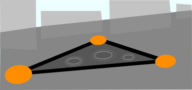
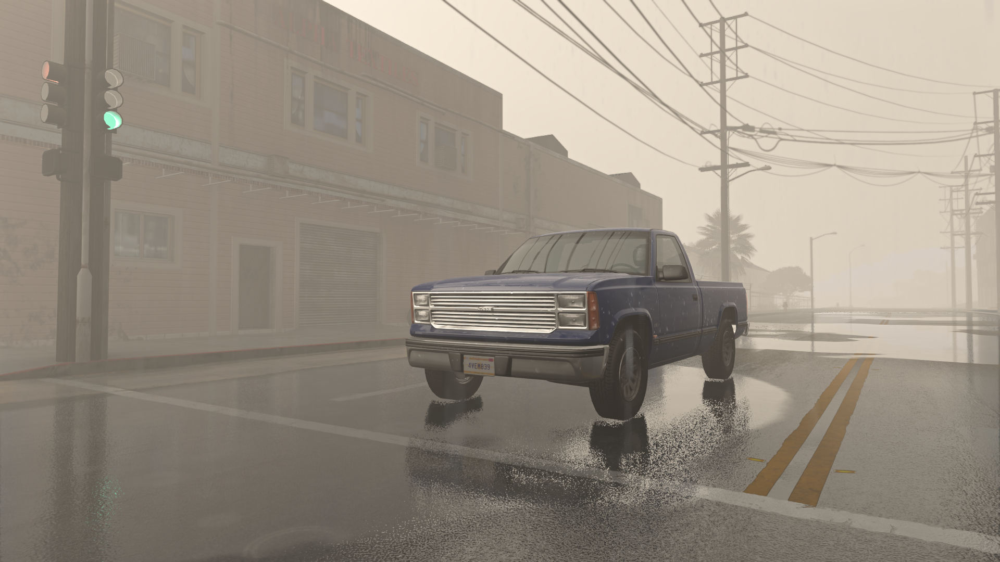
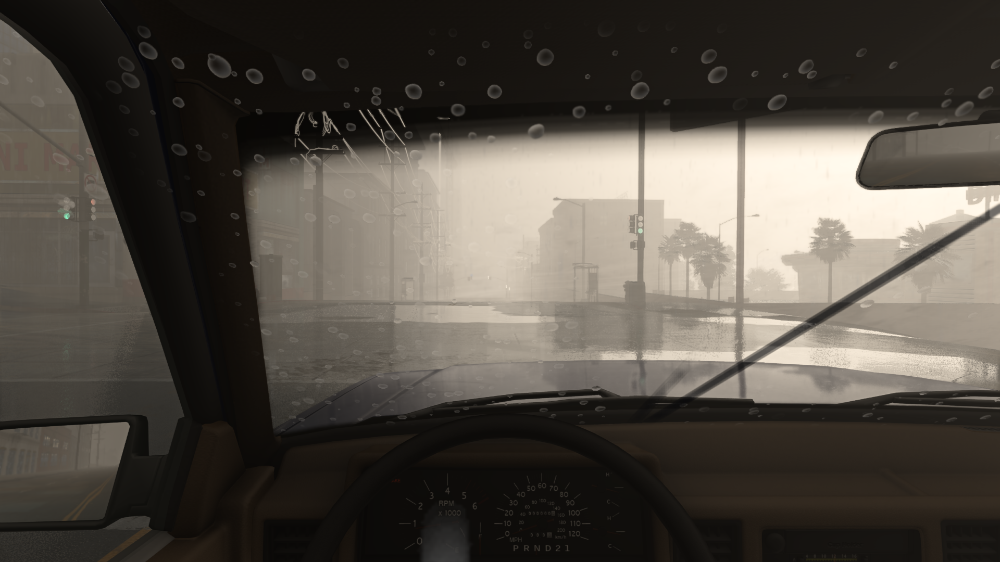
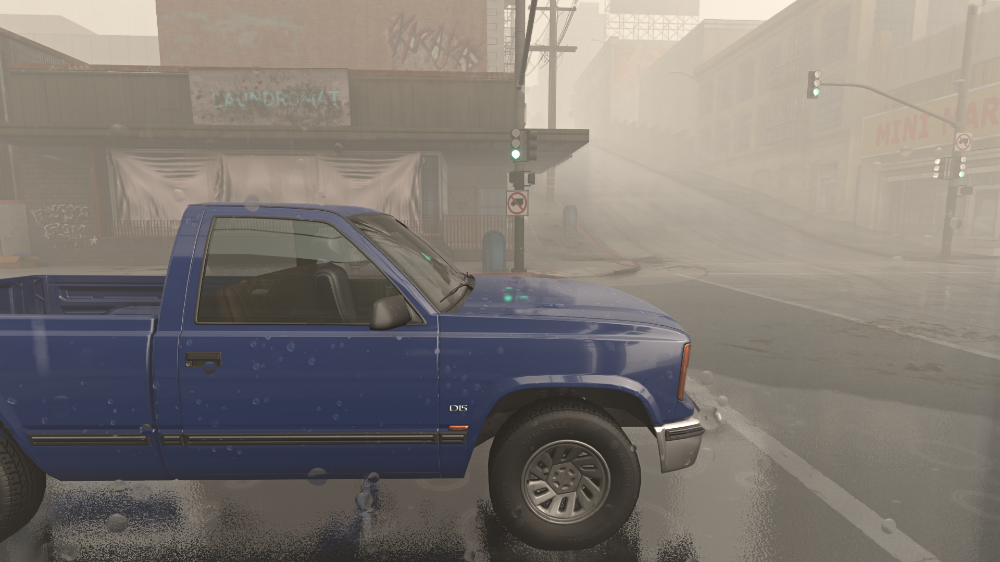
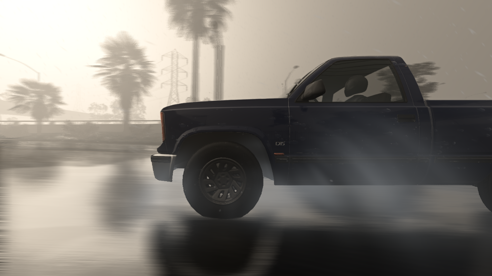

# ForeverWEATHER: Rain Puddles & Droplets

Light falling rain, wet roads, puddles with reflections, body droplets, rain on the windshield, rear and side windows with real wipers, dry tunnels, and tyre spray.

A graphics mod for **BeamNG.drive 0.40.x** (version 1.0.0). Everything is drawn by the mod's own compute shaders and Lua; it
needs no other mod.

## What it does

- Wet asphalt that darkens and turns glossy with the rain, plus puddles on roads with screen-space reflections and rain ripples.
- Droplets on every nearby car that bead, run off with gravity and stream backward with the airflow.
- Rain on your car's windshield, rear / hatch glass and side windows, from the driver's seat and from outside, cleared by automatic rain-sensing wipers.
- Tunnels, bridges and roofs: the ground under them stays dry and does not reflect, no rain lands on the glass there, the wipers finish a couple of sweeps and stop, and the drops on the cars slowly go (faster the faster you drive).
- Works together with the "Animated Wipers" mod if you have it (optional; nothing of it is included or changed): the rain sensor uses that mod's own wiper switch, and the glass clears exactly as its blades move.
- Its own falling rain, drawn on the graphics card instead of BeamNG's particle rain (which costs about 4 ms of CPU time per frame in heavy rain). Each drop refracts the scene behind it like a tiny lens.
- Tyre spray and wakes in puddles, camera lens droplets.
- Ground gets wet and dries over time; can follow the game's own weather.

**Settings:** Pause menu > Mods > Rain Puddles. Not sure what to tune? Use the Quick look buttons (Damp / Wet / Storm / Flooded) at the top. Console: `extensions.rainPuddles.openUI()`

## Install

1. Close the game.
2. Download [`release/rainPuddles.zip`](release/rainPuddles.zip) and put it, still zipped, into
   `<BeamNG user folder>/current/mods/` (remove older `rainPuddles` / `rain_puddles` zips first).
3. Start the game, load a map, press Esc and open **Mods > Rain Puddles**.

Add or remove the zip only while the game is closed: the game's mod manager drops a zip that appears or disappears
while it runs.

The repository root has the same layout as the zip (`art/`, `lua/`, `scripts/`, `shaders/`, `ui/`), so a copy of it in
`mods/unpacked/rainpuddles/` also works for development. After editing a shader, rename its folder
(`shaders/common/postFx/rainPuddlesNN`) and `shaderDir` in `lua/ge/extensions/rainPuddles.lua`, or the game keeps the
compiled old one.

## Screenshots

 

 

## 1.0.0 changes

- New: drops on the side windows (door and quarter glass) of your car, read from its own glass meshes, from the seat and from outside. They bead, run back with the airflow and run down when parked. Setting: 'Drops on the side windows too'.
- New: tunnels, bridges and roofs. Upward checks around the camera find what is covered: the ground there stays dry (no wet film, puddles or reflections), the tyres throw no spray, no new rain lands on the glass, the rain sensor gives a couple more sweeps (two, three when driving fast) and parks the wipers, and the drops on the cars slowly go (about 2.5 minutes parked, about 10 seconds at highway speed). Back in the rain everything returns within seconds. Near a tunnel the mod draws the wet road itself instead of the game's wet road materials, which would also shine inside the tunnel.
- Changed: the falling rain looks like water now. Each drop shows the scene behind it, bent like through a small lens (80 %), and a little of the sky (20 %), with its colours softened, so it never takes on a strong colour. Near drops are out of focus, the ends of each streak fade out, and there are less than half as many drops. At night the drops still catch the lights of the scene.
- Changed: a lighter tyre spray (thinner mist, at most 40 % opaque, lower default strength).
- Changed defaults: the longest and thickest reflection traces (48 steps, 2 m) for puddles and the wet road, so more of what is under and behind the cars shows in the reflections; stochastic glossy reflections on by default when a temporal upscaler (XeSS, DLSS, FSR) or TAA is on; glassier puddles and a slightly darker wet road. Settings you changed yourself are kept.
- Fixed: with Animated Wipers, right after its wipers were switched off the rain sensor could misread that mod's wiper switch as moved by hand and stop following the rain.
- New: falling rain drawn on the graphics card. Streaks with real depth that lean with the wind and rush at you when driving, no rain under roofs, bridges or in tunnels or inside your car, visible at night too (lit by lamps and headlights). It replaces BeamNG's particle rain, which is now off by default (you can still switch it on).
- New: 'Rain droplet size' (mm). The falling rain, the beads on the cars and the drops on the glass all scale with it, and the Quick looks set it. Drops are smaller by default.
- New: every bead on the cars and the glass has its own outline (stretched, a little lumpy) instead of a perfect circle.
- New: a measured wiper model per car. Each blade's pivot, reach and sweep and the part of the glass it wipes are measured in game for every car (nothing is stored per car): from where the Animated Wipers blades turn and how far, when that mod is installed, otherwise from the car's own wiper mesh. The glass clears exactly there, and the rain sensor picks the wiper speed by how much glass the blades clear per minute. Debug view 'Wiper model'; console: extensions.rainPuddles.getWiperModel().
- New: rear wiper on cars that have one (its own intermittent timing, or Animated Wipers' rear blade).
- New: optional 'Surroundings' reflection fallback. A small extra view of the scene above the camera, so puddle reflections that leave the top of the screen show trees, bridges and buildings instead of open sky. Its size follows the game's Dynamic Reflections quality.
- New: Quick look presets (Damp, Wet, Storm, Flooded) that set the rain and the whole wet road in one click.
- New: a more reflective wet road that still looks like asphalt: reflections build up toward grazing angles instead of turning the road into a mirror right in front of the car.
- New: the sky clouds over automatically while it rains; the level's own clouds come back when it stops.
- New: windshield rain follows the car's real glass. Its outline and curve are read from the car's own glass mesh (the jbeam windshield frame is the fallback), so rain stays off the dashboard, pillars, headliner, mirror and sunroof.
- New: drops on the rear / hatch glass too (read from the car's tailgate / rear-window glass mesh).
- New: windshield rain is also visible when you look at your car from outside, and the glass drops behave like the body drops: they bead, run down when parked, get blown up the glass at speed and streak, and braking or cornering moves them.
- New: the glass clears where the car's own wipers sweep. Blade count, pivots, lengths and parked angles are read from each car's wiper mesh in game. No fake blades are drawn.
- New: rain-sensing wipers. They start by themselves when rain lands on the glass and switch between intermittent, normal and fast with the rain and your speed; the glass clears at the speed in use. On a car with a wiper switch (e.g. the Midsize stalk) the switch follows.
- New: works together with the "Animated Wipers" mod when it is installed (nothing of it is included or changed). The rain sensor uses that mod's own wiper switch, the glass clears exactly when and as far as its blades sweep, and if you switch them by hand Rain Puddles follows you.
- Fixed: no more puddles, ripples or wet film inside a car (its floor, seats and dashboard, seen from the seat or through the glass).
- Fixed: rain ripples only in puddles, smaller and more like real rain rings (no flat rings across the road).
- Fixed: after resetting the car at speed, the lens drops and the glass drops kept streaking and slowed down over a second; they stop at once now.
- Fixed: the glass cleared in real time even in slow motion or pause; the wipers and the clearing now follow the simulation speed.
- Fixed: with Animated Wipers, the glass now clears exactly under its blades (the driver-side blade was read the wrong way round).
- Fixed: puddles and droplets sliding along when the camera moves (the camera position was one frame old). With that, puddles and wet film no longer show on the front or back of a moving car.
- Fixed: tyre spray behind a dark car looked like dark smoke; it is now a pale mist lit by the sky.
- Fixed: grainy speckles in wet-road reflections (most visible in a car's own mirror image).
- Fixed: with XeSS / DLSS / FSR upscaling, the windshield, tyre spray and puddle reflections read depth from the wrong spot.
- Fixed: droplets inside the cabin (headrests, dashboard, parcel shelf seen through the glass), using each car's roof line.
- Fixed: running droplets clipped at high speed (search window too small for long streaks).
- 12 cars (was 6) are kept free of puddles; right-hand-drive cars get mirrored wipers; official in-car camera detection; "open settings" console command fixed.

## Known issues

- Puddles may still appear on cars beyond the 12 nearest, or on static (non-driveable) car props.
- Body droplets may still show on a headrest or seat top that sits right under the roof line when seen through the rear window.
- Windshield, rear and side-window rain is drawn on your own car only. Each side's windows are one flat pane, so on strongly curved side glass the drops can sit a little off the glass.
- Without Animated Wipers, a blade's pivot can be mistaken for its tip on some wiper meshes, so that blade clears the wrong part of the glass (seen on the ETK 800's driver-side blade).
- Under a big rear wing the boot lid gets no beads: the wing counts as the car's roof line, which keeps drops off the interior seen through the glass.
- The default reflection traces are the longest and thickest ones: on a slower graphics card lower 'Trace steps' (puddles and wet road) first. Measured on West Coast USA at night with XeSS: about 2.3 ms of GPU time for the whole mod.
- The 'Surroundings' fallback only helps reflections that point steeply upward (the rest stays on screen). It costs about 0.3-0.4 ms per frame at Normal Dynamic Reflections quality and is off by default.
- Roofs are sampled every 4 m within about 18 m of the camera: rain can fall a little past the edge of a roof, the dry ground under a bridge has soft edges, and far beyond that the nearest sample decides (a long tunnel stays dry ahead). Seen from far outside, the road inside a tunnel can still look glossy until you get closer.
- With 'Follow the game's weather' on, the game's own particle rain falls as well as this mod's.
- Modded cars whose glass meshes are not named like the official ones fall back to the jbeam windshield frame (or, in the cockpit, an estimated plane) and get no rear-glass drops. Cars without a wiper mesh get generic tandem wipers.
- BeamNG cars have no wiper motor, so without Animated Wipers the wiper speed comes from the mod's rain sensor and its 'Wiper speed' slider.
- Very long droplet streaks are capped at extreme speeds to keep the cost bounded.

## BeamNG.Earth companion

[`companions/rainPuddles_earth`](companions/rainPuddles_earth) (zip: [`release/rainPuddles_earth.zip`](release/rainPuddles_earth.zip))
lets Rain Puddles draw the rain on the BeamNG.Earth map, from that map's real weather. On every other map it does nothing.
See its [README](companions/rainPuddles_earth/README.md).

## Repository layout

| Path | What |
|---|---|
| `lua/ge/extensions/rainPuddles.lua` | main game-engine extension: settings, rain, wet ground, glass panes, wipers, shelter grid, shader constants |
| `lua/ge/extensions/rainPuddlesWet.lua` | native wet-road film (road material roughness while it rains) |
| `lua/vehicle/extensions/` | vehicle side: wheel / windshield probe, the optional Animated Wipers bridge |
| `shaders/common/postFx/rainPuddles20/` | compute shaders: puddles + wet ground, body droplets, glass, falling rain, spray, lens |
| `ui/ui-vue/mods/RainPuddles/` | settings panel (Pause menu > Mods > Rain Puddles) |
| `art/rainPuddles/` | masks, droplet atlas, wiper sweep texture |
| `release/` | ready-to-install zips |
| `docs/` | banner, screenshots, Linux / Vulkan notes, change logs of the 0.x versions |

## Animated Wipers

The optional bridge to the "Animated Wipers" mod only reads the data that mod publishes (its wiper switch and blade
positions) and uses its own wiper switch. Nothing of that mod is included in this repository or changed by it; without it
installed, Rain Puddles runs its own rain-sensing wiper timeline.
