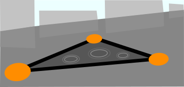
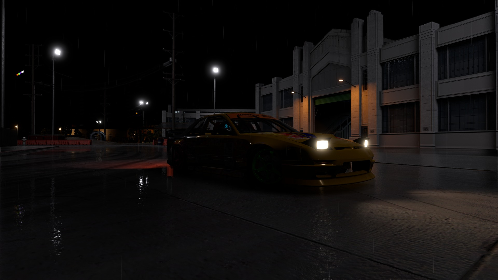
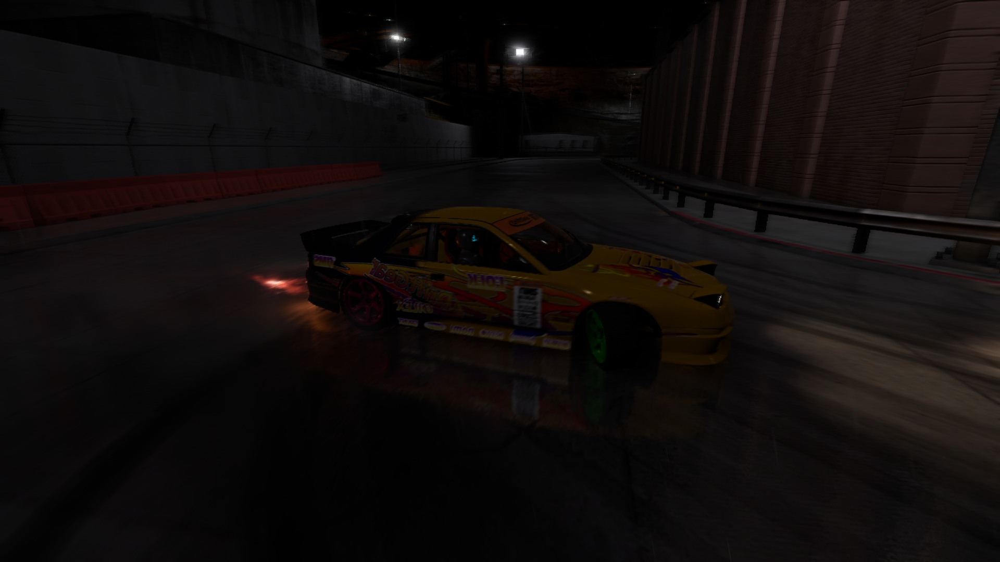
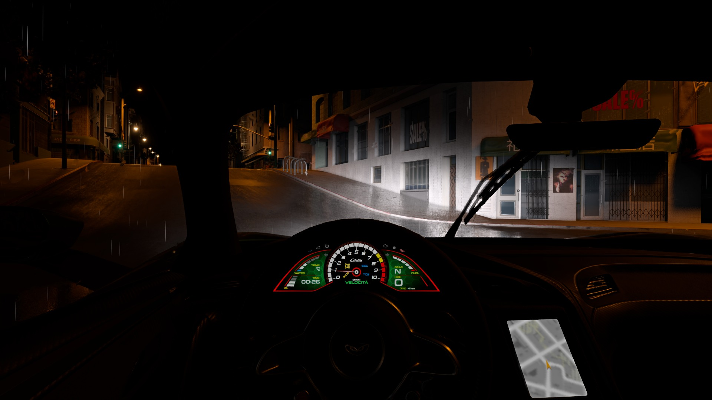
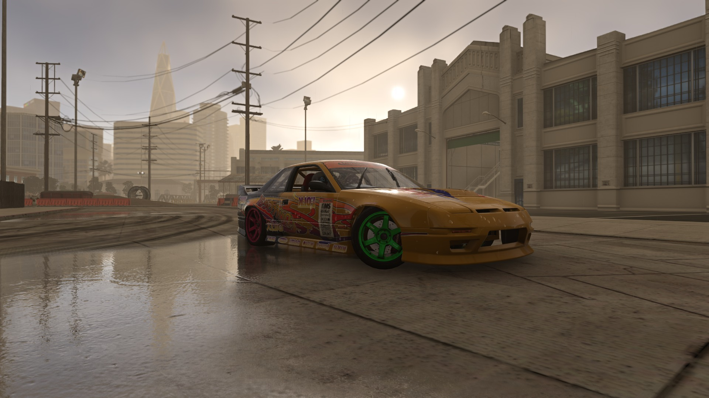

# ForeverWEATHER: Rain Puddles & Droplets

Falling rain, wet roads, puddles with reflections, node-based hydroplaning, body droplets, rain on the windshield, rear and side windows with real wipers, lens drops, dry tunnels, tyre spray, and a night street-racer look.

A graphics and physics mod for **BeamNG.drive 0.40.x** (version 1.3.0 **Alpha**). Everything is drawn by the mod's own compute
shaders and Lua; it needs no other mod.

> **DX12 and Vulkan only.** DX11 doesn't support SSR on BeamNG.drive currently, and the mod utilizes SSR for the puddles.
> 
> **Alpha release.** Expect rough edges; please report problems as issues.
>
> **Made with AI.** This mod was written by an AI assistant, Claude (by Anthropic) working in Claude Code: all of its
> code, shaders, settings panel and texts, including this page. Blaze-Archi directed the work, tested it in game and
> chose what stays. See [About the AI](#about-the-ai) below.

## What it does

- Wet asphalt that darkens and turns glossy with the rain, plus puddles on roads with screen-space reflections, rain ripples and tyre wakes. Water only stands on level ground: no puddles on hills.
- Droplets on every nearby car: round beads, teardrops and elongated running drops that bead, run off with gravity and stream backward with the airflow. Each one is a small lens: clear water that shows an upside-down view of what is around it, and its rim catches bright light (the sky over a dark car, lit streets and lamps at night), so the drops show in the dark too. At night the street lamps make tiny sparks on them.
- Rain on your car's windshield, rear / hatch glass and side windows, from the driver's seat and from outside, cleared by automatic rain-sensing wipers. The drops on the glass are lenses like the ones on the paint, and at night the windshield glitters with the street lamps.
- Drops on the camera lens all over the screen, blown toward the edges as you drive.
- Node-based hydroplaning (Arcade / Simcade / Sim): the water under each tyre's contact-patch nodes (the road film and exactly the puddles you see) lifts them off the road against the tyre's own pressure and drags them back, so grip fades in deep water at speed and one wheel in a puddle pulls the car.
- Tunnels, bridges and roofs: the ground under them stays dry and does not reflect, no rain lands on the glass there, the wipers finish a couple of sweeps and stop, and the drops on the cars slowly go (faster the faster you drive).
- Works together with the "Animated Wipers" mod if you have it (optional; nothing of it is included or changed): the rain sensor uses that mod's own wiper switch, and the glass clears exactly as its blades move.
- Its own falling rain, drawn on the graphics card instead of BeamNG's particle rain (which costs about 4 ms of CPU time per frame in heavy rain). Each drop refracts the scene behind it like a tiny lens.
- Tyre spray and wakes in puddles.
- **Midnight:** a night street-racer look with soaked streets, the street lamps' halos in the wet night air (each lamp in its own colour), a glow of the city on the overcast sky and a night film grade. A **Random mood** button picks a moody weather: blue hour drizzle, golden storm, grey downpour, dawn mist or Midnight.
- The ground gets wet and dries over time. It can follow the game's own weather, and on the BeamNG.Earth map that map's real weather (the bridge is built in).

**Pause menu > Mods > ForeverWEATHER.** Not sure what to tune? Use the Quick look buttons (Damp / Wet / Storm / Flooded / Midnight) at the top. Console: `extensions.rainPuddles.openUI()`

## Hydroplaning

Node-based, in each car's own physics at the physics rate (2000 Hz):

1. **Contact patch.** Every tyre's tread nodes are put in ring order around the axle; the ones touching the road are
   followed as the wheel turns.
2. **Water under each node.** The road's water film plus the puddles, from exactly the puddle field the shader draws
   (the same masks, tiling, coverage and depth ramp), inside the road lanes, never under a roof, only on level ground
   (the same slope limit as the puddles you see) and only on hard ground (asphalt, concrete, cobbles). Dirt, grass and
   sand soak the water up.
3. **Drainage.** The tread drains what it can: tread depth by tyre type (slicks, semi-slicks, race, off-road tyres are
   recognised by part name) or the *Tread depth* setting, less at speed.
4. **Lift.** The water pressure in front of the patch, ½ ρ v² C_L, against the tyre's real inflation pressure, carries
   part of each node's load: the node is pushed up off the road and BeamNG's own tyre model loses the grip there. No
   friction value is faked. A 2.2 bar road tyre floats completely at about 95 km/h in a deep puddle (*Sim*), close to
   Horne's classic V ≈ 6.36 √p (kPa) km/h.
5. **Drag.** The water the tyre has to push aside drags its leading nodes back: the wheel slows (spin-down) and one
   wheel in a puddle pulls the car.

| Mode | Lift coefficient | Most of the load the water can carry | Water needed above what the tread drains |
|---|---|---|---|
| Arcade | 0.30 | 45 % | 6 mm |
| Simcade | 0.45 | 65 % | 4 mm |
| Sim | 0.70 | 95 % | 2.5 mm |

Settings: *Water strength*, *Tread depth*, traffic too (within 400 m), and a debug view that colours every contact-patch
node (blue = water under it, red = load the water carries). Cost: about 0.05 ms per frame for the player's car.

## Screenshots

In game, at the author's own graphics settings, not edited.

**Night**

<table>
<tr><td></td><td></td></tr>
<tr><td></td><td></td></tr>
<tr><td></td><td></td></tr>
</table>

**Day**

<table>
<tr><td></td><td></td></tr>
<tr><td></td><td></td></tr>
<tr><td></td><td></td></tr>
<tr><td></td><td></td></tr>
</table>

## Install

1. Close the game.
2. Download `ForeverWEATHER.zip` from the [latest release](https://github.com/Blaze-Archi/ForeverWEATHER/releases/latest)
   (or [`release/ForeverWEATHER.zip`](release/ForeverWEATHER.zip)) and put it, still zipped, into
   `<BeamNG user folder>/current/mods/`. Remove older `rainPuddles.zip` / `rain_puddles` zips and the old
   `rainPuddles_earth.zip` companion first: since 1.2.0 the zip is called ForeverWEATHER, and the BeamNG.Earth bridge has
   been inside it since 1.0.2. Your settings stay.
3. Start the game, load a map, press Esc and open **Mods > ForeverWEATHER**.

Add or remove the zip only while the game is closed: the game's mod manager drops a zip that appears or disappears
while it runs.

The repository root has the same layout as the zip (`art/`, `lua/`, `mod_info/`, `scripts/`, `shaders/`, `ui/`), so a
copy of it in `mods/unpacked/foreverweather/` also works for development. After editing a shader, rename its folder
(`shaders/common/postFx/rainPuddlesNN`) and `shaderDir` in `lua/ge/extensions/rainPuddles.lua`, or the game keeps the
compiled old one.

## What's new in 1.3.0

- **Glass drops like the body drops.** The drops on the windshield, rear and side windows use the same optics as the
  beads on the paint: refraction (each drop shows a small, upside-down image of the world around it), Fresnel on the
  same scale (default 0.12, it was 1.0) and Light catch. No more bubbles by day: the fixed white highlight, the milky
  veil and the wide dark ring are gone. From the seat a drop has the thin dark outline of real water. New slider:
  Glass drops: light catch.
- **Light catch at night.** The 8 nearest street lamps make tiny, sharp sparks in the drops. From the seat the
  windshield glitters under street lights, and the beads on the paint sparkle. Mostly white and about a pixel in size,
  so the lamps never tint the beads.
- **Puddles keep the angle.** 'Reflectivity' is the water's reflectance straight down, rising toward the horizon like
  real water (at the default, the puddles right in front of you mirror 6 % instead of 15 %; far away nothing changes).
- **Light streaks.** Street lamps on rough wet asphalt stretch into long streaks toward you (up to 5x at low angles);
  deep puddles keep a sharp mirror image.
- **Fixes.** No pass can write a broken (NaN) pixel any more, which the game's anti-aliasing could spread into black
  flicker on cars and in the cabin; a softer in-car mask edge; the sky behind the windshield; the wipers after a vehicle
  reset (with Animated Wipers); hydroplaning and lens-drop edge cases.

Full notes: [docs/history/CHANGES_v1.3.0.md](docs/history/CHANGES_v1.3.0.md).

## What's new in 1.2.1

- **Light catch** (Vehicle droplets, default 1.5). With 1.2.0's low Fresnel the beads were clear water but nearly
  vanished on dark paint and at night. Now, where a bead's rim mirrors something far brighter than the paint around it
  (the sky over a dark car, lit streets and street lamps at night), the rim mirrors more, up to 1.5 times the water's
  own Fresnel. Beads on mid and light paint by day stay clear lenses. It only brightens the rims, never tints them.

Full notes: [docs/history/CHANGES_v1.2.1.md](docs/history/CHANGES_v1.2.1.md).

## What's new in 1.2.0

- **Renamed:** the zip is `ForeverWEATHER.zip` now, and the game's mod manager shows the mod's icon and description.
- **Drops on the cars are clear water, not bubbles.** Fresnel 0.12 (was 1.0, which turned every bead's rim into a
  mirror), refraction 1.75 (was 1.0; the slider goes to 2.5). The street lamps no longer colour the beads.
- **Elongated teardrops.** A new droplet shape, a slim line that swells into a small round head, for the drops running
  over the car (most of them at speed). Round beads and teardrops stay.
- **Glass drops** (windshield, rear and side windows) have their own *Refraction* and *Fresnel* sliders.
- **Lens drops all over the screen.** Rain lands anywhere on the lens, also in the middle, and drifts to the edges more
  gently as you drive (about 3 times slower than before). Round, with a slight hint of a teardrop.
- **No puddles on slopes.** Puddles fade out between 3 % and 5 % grade (new slider: *Steepest ground for puddles*). The
  slope is measured from the road's real shape (the depth buffer), and hydroplaning uses the same limit.
- **From 1.1.1** (not released on its own): puddles and the wet ground reach further (sliders up to 600 m and 800 m),
  up to 24 street lamps within 300 m light the wet road and Midnight's air, and Midnight keeps every light's own colour.

Full notes: [docs/history/CHANGES_v1.2.0.md](docs/history/CHANGES_v1.2.0.md).

## Earlier versions

- [1.1.0](docs/history/CHANGES_v1.1.0.md): Midnight's night film with lamp halos in the air, random moody weather,
  Fresnel and much stronger refraction for the drops on the cars, tyre spray that builds up and fades instead of
  popping.
- [1.0.2](docs/history/CHANGES_v1.0.2.md): wet asphalt instead of a mirror (reflection energy follows the roughness,
  glossy blur), street-lamp highlights on the wet road at night, the BeamNG.Earth bridge built in, an API for other
  weather mods.
- [1.0.1](docs/history/CHANGES_v1.0.1.md): the road flicker fixed, no lens drops or rain at start-up, calmer wet look,
  and the first Midnight.
- [1.0.0](docs/history/CHANGES_v1.0.0.md) and the 0.x versions: [docs/history](docs/history).

## Known issues

- Puddles may still appear on cars beyond the 12 nearest, or on static (non-driveable) car props.
- Body droplets may still show on a headrest or seat top that sits right under the roof line when seen through the rear window.
- Windshield, rear and side-window rain is drawn on your own car only. Each side's windows are one flat pane, so on strongly curved side glass the drops can sit a little off the glass.
- Without Animated Wipers, a blade's pivot can be mistaken for its tip on some wiper meshes, so that blade clears the wrong part of the glass (seen on the ETK 800's driver-side blade).
- Under a big rear wing the boot lid gets no beads: the wing counts as the car's roof line, which keeps drops off the interior seen through the glass.
- Hydroplaning reads the water from the same puddle field as the shader, but it does not see the tyre wakes (the water a car ahead pushed aside) except for a car's own front-to-rear track. Tyres are recognised by part name; a modded tyre with an unusual name counts as an ordinary road tyre ('Tread depth').
- The default reflection traces are the longest and thickest ones: on a slower graphics card lower 'Trace steps' (puddles and wet road) first. Measured with 1.0.0 on West Coast USA at night with XeSS: about 2.3 ms of GPU time for the whole mod; later versions were not measured again.
- The puddles' slope limit reads the slope from the depth buffer a few pixels around each point: right at the edge of a kerb, a car or a building it can be a little off, so a puddle can stop a little short of where a slope begins.
- The 'Surroundings' fallback only helps reflections that point steeply upward (the rest stays on screen). It costs about 0.3-0.4 ms per frame at Normal Dynamic Reflections quality and is off by default.
- Roofs are sampled every 4 m within about 18 m of the camera: rain can fall a little past the edge of a roof, the dry ground under a bridge has soft edges, and far beyond that the nearest sample decides (a long tunnel stays dry ahead). Seen from far outside, the road inside a tunnel can still look glossy until you get closer.
- With 'Follow the game's weather' on, the game's own particle rain falls as well as this mod's.
- Modded cars whose glass meshes are not named like the official ones fall back to the jbeam windshield frame (or, in the cockpit, an estimated plane) and get no rear-glass drops. Cars without a wiper mesh get generic tandem wipers.
- BeamNG cars have no wiper motor, so without Animated Wipers the wiper speed comes from the mod's rain sensor and its 'Wiper speed' slider.
- Very long droplet streaks are capped at extreme speeds to keep the cost bounded.

## BeamNG.Earth

Since 1.0.2 the bridge to BeamNG.Earth is part of the mod (`lua/ge/extensions/rainPuddlesEarth.lua`): on the BeamNG.Earth
map, that map's real weather (rain, temperature, wind, clouds, visibility, snow) drives the rain, the drop size, how fast
the ground gets wet and dries, the puddles and the spray. On every other map it does nothing. The separate
`rainPuddles_earth` companion of 1.0.0 is no longer needed: remove it if you have it.

## Repository layout

| Path | What |
|---|---|
| `lua/ge/extensions/rainPuddles.lua` | main game-engine extension: settings, rain, wet ground, glass panes, wipers, shelter grid, lamps, Midnight, shader constants |
| `lua/ge/extensions/rainPuddlesWet.lua` | optional native wet-road film (road material roughness; only in *Native PBR + SSR* mode) |
| `lua/ge/extensions/rainPuddlesHydro.lua` | hydroplaning, game-engine side: puddle field, lanes, roofs and slopes for each car |
| `lua/ge/extensions/rainPuddlesEarth.lua` | bridge to BeamNG.Earth's real weather (only active on that map) |
| `lua/vehicle/extensions/rainPuddlesHydroVeh.lua` | hydroplaning, vehicle side: contact-patch nodes, water depth, lift and drag at the physics rate |
| `lua/vehicle/extensions/` (other files) | wheel / windshield probe, the optional Animated Wipers bridge |
| `shaders/common/postFx/rainPuddles39/` | compute shaders: puddles + wet ground, body droplets, glass, falling rain, spray, lens, Midnight grade |
| `ui/ui-vue/mods/RainPuddles/` | settings panel (Pause menu > Mods > ForeverWEATHER) |
| `art/rainPuddles/` | puddle masks (and their raw fields for the physics), droplet atlas, wiper sweep texture |
| `mod_info/FOREVERWEATHER/` | icon and description for the game's mod manager |
| `release/` | the ready-to-install zip |
| `docs/` | banner, screenshots, Linux / Vulkan notes, change logs |

## Animated Wipers

The optional bridge to the "Animated Wipers" mod only reads the data that mod publishes (its wiper switch and blade
positions) and uses its own wiper switch. Nothing of that mod is included in this repository or changed by it; without it
installed, ForeverWEATHER runs its own rain-sensing wiper timeline.

## About the AI

All of this mod's code was written by an AI assistant: Claude (Anthropic), in Claude Code. That covers the Lua, the
HLSL compute shaders, the Vue settings panel, the documentation and this README. The commits are marked
"Co-Authored-By: Claude". Blaze-Archi set the goals, played and tested each version in game, reported what looked or
felt wrong, and decided what goes in. The screenshots were taken in game with the mod. The banner was made by
Blaze-Archi.
